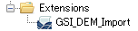
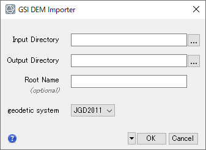
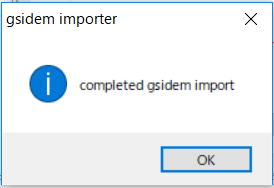
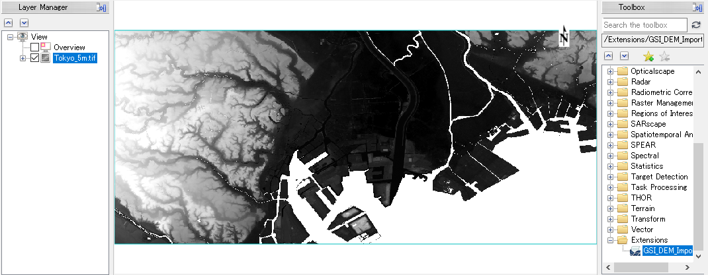

# GSI-DEM

国土地理院の基盤地図情報からダウンロードした数値標高モデル（DEM）をENVIへインポートし、モザイクしたGeoTIFFとして出力する拡張ツールです。

本リポジトリはソースコードの管理を目的としたものではありません。NV5 Geospatial株式会社で動作確認した実行ファイルと、その利用方法を配布するためのものです。

対応するENVI / IDLのバージョンや、リリースごとの変更点については、[Releases](../../releases)を確認してください。

## 対応データ

本ツールは、基盤地図情報の数値標高モデルのうち、次のデータに対応しています。

- 5mメッシュ: 5A、5B、5C（混在可）
- 10mメッシュ: 10B（地形図の等高線）

入力フォルダ内のXMLファイルを読み込み、メッシュ種別ごとにモザイクしてGeoTIFF形式で出力します。

数値標高モデルは、国土地理院の基盤地図情報ダウンロードサービスから取得してください。

- [基盤地図情報ダウンロードサービス](https://fgd.gsi.go.jp/download/menu.php)

## 動作要件

- ENVI / IDLがインストールされていること
- 本ツールを実行可能なENVI / IDLライセンスを利用できること
- 対応する基盤地図情報の数値標高モデルがダウンロード済みであること

> [!IMPORTANT]
> 本ツールの実行には、ENVI / IDLのライセンスが必要です。

## 対応バージョンとリリース情報

対応するENVI / IDLのバージョンは、リリースごとに異なる場合があります。使用する実行ファイルに対応した製品バージョンと変更内容は、GitHubの[Releases](../../releases)で確認してください。

## 配布ファイル

| ファイル | 説明 |
| --- | --- |
| `GSI_DEM_Import.sav` | GSI-DEMツール本体 |

## インストール

1. `GSI_DEM_Import.sav`を、ENVIの`extensions`フォルダにコピーします。

   ```text
   <Install-Dir>\ENVIxx\extensions
   ```

   標準的なインストール先は次のとおりです。

   ```text
   C:\Program Files\NV5\ENVIxx\extensions
   ```

   `ENVIxx`は、使用しているENVIのバージョンに対応するフォルダ名に読み替えてください。

2. ENVIを起動します。すでに起動している場合は、ファイルの配置後にENVIを再起動してください。
3. Toolboxの**Extensions**に**GSI_DEM_Import**が表示されることを確認します。



*Toolboxに追加されたGSI_DEM_Import*

## 入力データの準備

1. ダウンロードした数値標高モデルの圧縮ファイルを解凍します。
2. インポートするXMLファイルを同じフォルダに配置します。

本ツールは指定フォルダ内から対象XMLファイルを検索するため、同じフォルダにほかの拡張子のファイルが含まれていても処理できます。

## 使用方法

1. ENVIのToolboxから**Extensions > GSI_DEM_Import**をダブルクリックします。
2. パラメータ設定画面で、処理に必要な項目を指定します。

   

   *GSI_DEM_Importのパラメータ設定画面*

3. **OK**をクリックして処理を実行します。
4. 処理完了ダイアログが表示されたら、**OK**をクリックします。
5. 出力されたGeoTIFFがENVIに表示されることを確認します。



*処理完了ダイアログ*

### パラメータ

| パラメータ | 説明 |
| --- | --- |
| `Input Directory` | インポートするXMLファイルを配置したフォルダを指定します。 |
| `Output Directory` | 処理結果を保存するフォルダを指定します。 |
| `Root Name` | 出力ファイルのルート名を指定します。未指定の場合は`out`が使用されます。 |
| `Geodetic system` | 測地系として`JGD2011`または`JGD2000`を選択します。数値標高モデルをダウンロードした時期やデータの仕様に応じて選択してください。 |

## 出力ファイル

出力ファイル名は、入力した`Root Name`とメッシュ種別から決まります。

| 入力データ | 出力ファイル名 |
| --- | --- |
| 5mメッシュ | `<Root Name>_5m.tif` |
| 10mメッシュ | `<Root Name>_10m.tif` |

例えば、`Root Name`に`out`を指定した場合は、次のファイルが出力されます。

```text
out_5m.tif
out_10m.tif
```

## 標高値とNo Dataの取り扱い

本ツールは、数値標高モデルに記録された標高値をそのままインポートします。海水面などに設定されている`-9999.0`は、出力GeoTIFFの`Data Ignore Value`として設定されます。

このため、ENVIで該当ピクセルの値を確認すると、数値ではなく`No Data`と表示されます。



*出力結果とNo Dataの表示例*

## 中間生成物

処理を実行すると、`Output Directory`の配下に`ENVITemp`から始まるフォルダが作成されます。このフォルダには、読み込んだ各XMLファイルに対応するENVI形式の中間生成物が保存されます。

処理結果の確認後、中間生成物が不要な場合は、`ENVITemp`から始まるフォルダを削除できます。

> [!CAUTION]
> 削除する前に、出力されたGeoTIFFが正常に作成され、ENVIで表示できることを確認してください。

## 利用上の注意

- 入力データに適した測地系を選択してください。
- 出力結果の座標、標高値、欠損値を利用者の責任で確認してください。
- 大量のXMLファイルを処理する場合、一時的に多くのディスク容量を使用することがあります。
- 中間生成物は自動では削除されません。必要に応じて処理後に削除してください。

## 免責事項

本ツールは現状有姿で提供されます。利用環境やデータを含むすべての条件における動作を保証するものではありません。利用者の責任において、出力結果を確認したうえで使用してください。

## お問い合わせ

本ツールの実行には、ENVI / IDLのライセンスが必要です。

ご不明な点がある場合は、NV5 Geospatial株式会社 技術サポートまでお問い合わせください。

- Email: [support_jp@nv5.com](mailto:support_jp@nv5.com)
